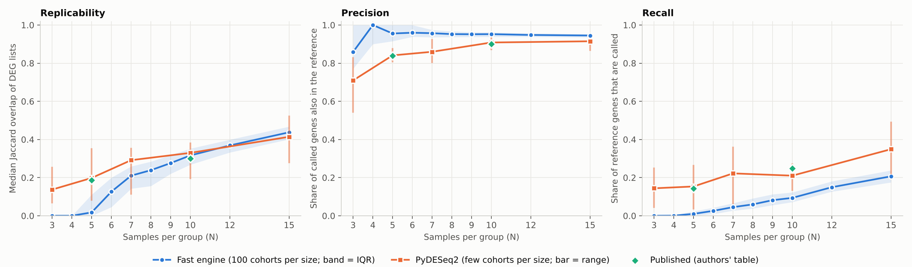
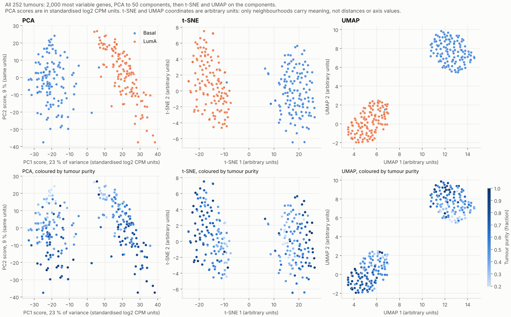
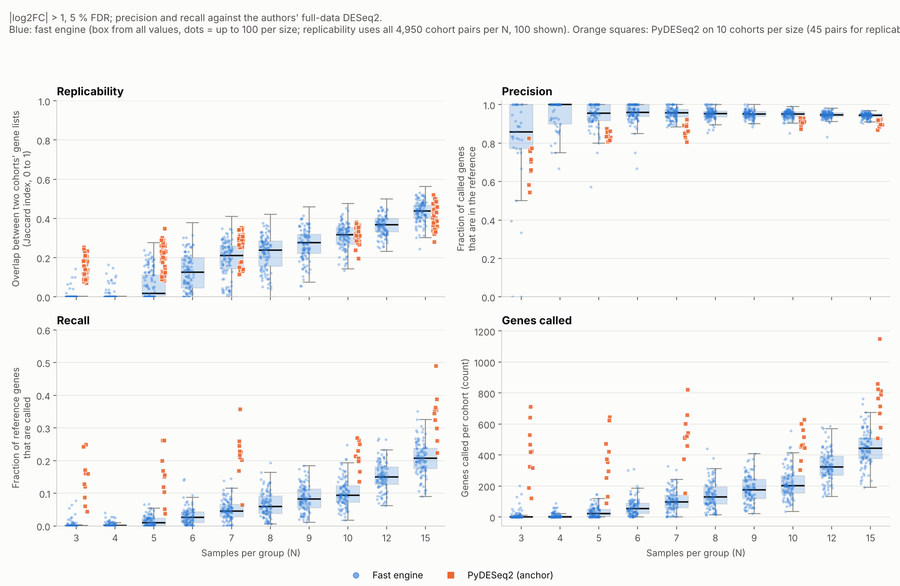
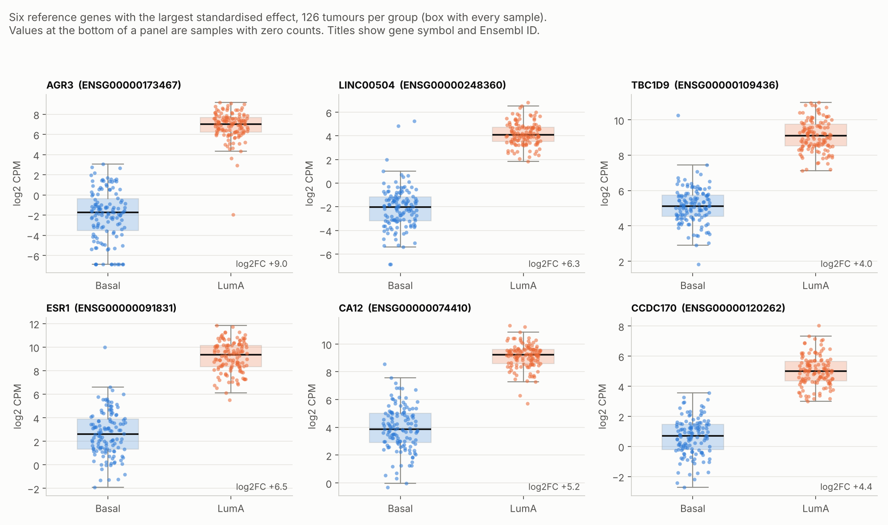

# RNA-seq replicability: a reproduction of Degen & Medo (2025)

How reliable are differential-expression results when a study has only a handful of replicates? This repository
reproduces the paper's subsampling experiment on one of its data sets, TCGA breast cancer **Basal vs Luminal A
(126 vs 126 tumours)**, and ships an interactive dashboard of the results.

> Degen P, Medo M. *Replicability of bulk RNA-Seq differential expression and enrichment analysis results for small
> cohort sizes.* PLOS Computational Biology (2025). [doi:10.1371/journal.pcbi.1011630](https://journals.plos.org/ploscompbiol/article?id=10.1371/journal.pcbi.1011630)

**Dashboard:** open `docs/index.html` in a browser (no server needed), or run `make serve`.
**Write-up:** [`report/report.md`](report/report.md).



## Result in one table

PyDESeq2 (the closest available match to the paper's DESeq2 pipeline), 10 random cohorts per size, primary setting
(|log2FC| > 1 formal threshold, 5 % FDR, tumour purity and age as covariates). Precision and recall are measured against
the authors' full-data DESeq2 result.

| | Published N=5 | Reproduced N=5 | Published N=10 | Reproduced N=10 |
|---|---|---|---|---|
| Precision | 0.84 | 0.84 | 0.90 | 0.91 |
| Recall | 0.14 | 0.15 | 0.25 | 0.21 |
| Replicability (median Jaccard of DEG lists) | 0.19 | 0.20 | 0.30 | 0.33 |

Across sizes, replicability climbs from 0.14 at 3 per group to 0.41 at 15 per group: even at 15 replicates, two cohorts
agree on well under half of their differentially expressed genes. Precision is high from about 5 per group, while recall
stays low, so small studies report a short list of mostly real genes and miss most of the rest.

### Beyond the headline metrics

| | |
|---|---|
|  | PCA, t-SNE and UMAP of all 252 tumours. Basal and Luminal A separate cleanly in every projection (PC1 alone carries 23 % of the variance). |
|  | Cohort-to-cohort spread of replicability, precision, recall and genes called, as box plots with every cohort drawn as a dot (violin version: `figures/fig8_cohort_metrics_violin.png`; `fig9` restricts replicability to pairs where both cohorts call 10+ genes). Orange squares are the PyDESeq2 anchor cohorts. t-SNE and UMAP axes are labelled in arbitrary units because those embeddings have no physical scale; PCA scores are in standardised log2 CPM units. |
|  | Expression of the six reference genes with the largest effect, one dot per tumour (violin version: `figures/fig6_top_genes_violin.png`). |

The dashboard has all of these as interactive panels: switch projection and colouring, overlay any of the random cohorts on the
sample map, pick any of 40 genes, and flip every distribution between box-and-dots and violin.

## What is in here

```
config/config.yaml                 all analysis parameters
data/                              inputs copied from the authors' BootstrapSeq repo (see data/README.md)
workflow/fast_de.py                numpy DE engine (limma-trend style, covariates, formal fold-change test)
workflow/cohorts.py                deterministic random-cohort planner
workflow/run_sweep.py              main analysis: 1,000 cohorts (10 sizes x 100) x 6 threshold settings
workflow/pydeseq2_crosscheck.py    PyDESeq2 anchor (slow, resumable): 50 cohorts
workflow/validate_engine.py        agreement of both engines with the authors' own results
workflow/make_report.py            tables for the report, generated from results/
workflow/fetch_gene_annotation.py  gene symbols (annotables, GPL-3 data; see data/README.md)
workflow/embeddings.py              PCA, t-SNE, UMAP and top-gene expression for the sample-level views
workflow/make_figures.py           static figures (metrics by cohort size, gene recurrence, published data sets)
workflow/make_figures_extra.py     static figures (embeddings, box-with-dots and violin plots)
workflow/build_dashboard.py        builds docs/index.html (self-contained; works on GitHub Pages)
results/                           all outputs (CSV, plus the DEG set of every anchor cohort as JSON)
report/                            write-up, generated tables, engine validation
tests/test_fast_de.py              calibration and sanity tests for the fast engine
```

## Reproduce

```bash
pip install -r requirements.txt
make test          # engine sanity tests
make all           # sweep (~1 min), embeddings (~20 s), validation, tables, figures, dashboard
make anchor        # optional and slow: about 1 min per cohort, ~50 min for the 50 stored cohorts; resumable
```

Every random draw is seeded from `(seed, N, trial)`, so reruns give identical cohorts.

## Read this before citing the numbers

- **R was not available when this was built**, so the paper's DESeq2 and edgeR were not run. The headline numbers come
  from PyDESeq2. A faster engine (`fast_de.py`) produced the 100-cohorts-per-size sweep; it is **conservative below about
  7 samples per group** (it calls no genes at all in 64 % of N = 3 cohorts), so its small-N values are not comparable with
  the paper. At N = 7, 10 and 15, the sizes compared, it tracks PyDESeq2 closely. Both engines are validated in `report/validation.md`.
- **One data set of the paper's 18**, and **no enrichment analysis**. The GEO data sets were outside this environment's
  network allowlist.
- The PyDESeq2 anchor uses only 10 cohorts per size (45 cohort pairs), so its medians are noisy.
- The list of cohort sizes between 3 and 15 and the exact meaning of the `BSLA` label were taken from the authors'
  repository, not confirmed against the paper's tables.
- The reference ("truth") is the full-data analysis of the same samples, as in the paper.

## Credit and licence

Data and reference results: [pdegen/BootstrapSeq](https://github.com/pdegen/BootstrapSeq) (MIT), derived from TCGA. This is
an independent reproduction and is not affiliated with the authors. Code here: MIT (see `LICENSE`).
