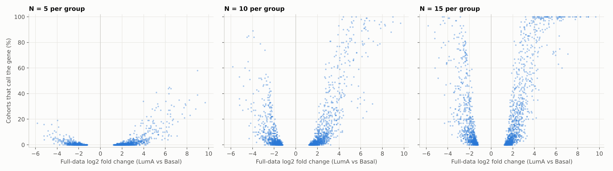
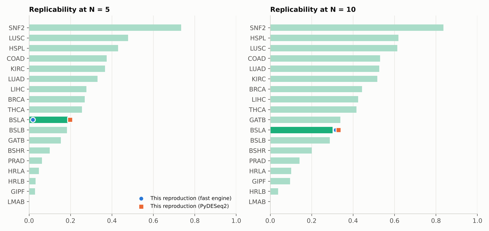
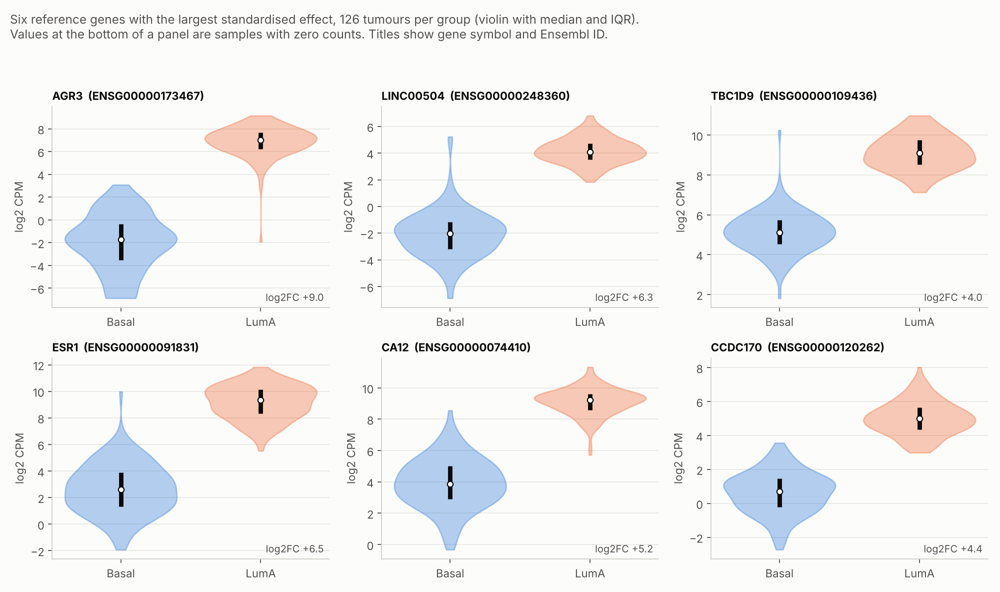
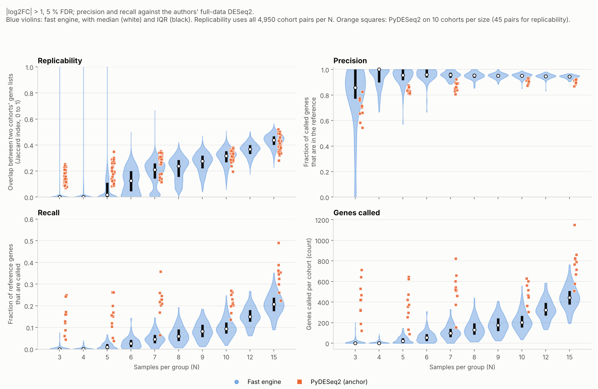
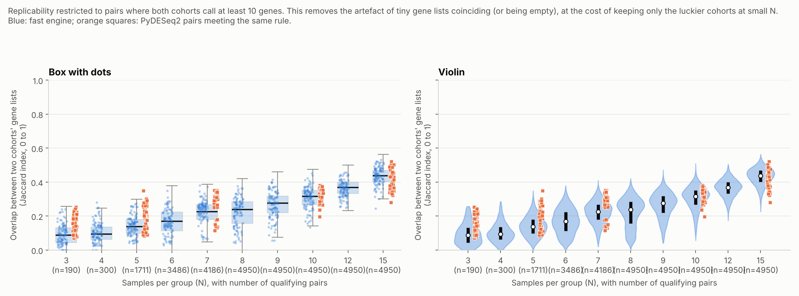

# Report: reproducing the small-cohort replicability experiment on TCGA Basal vs LumA

## Question

When a differential-expression study has few replicates, how much of what it reports would another study of the same
size find again, and how much of the full truth does it recover? Degen & Medo (2025) answer this by repeatedly drawing
small random cohorts from large RNA-seq data sets. This report reproduces that design on one of their data sets.

## Design (what was actually done)

- **Data.** TCGA breast cancer, Basal vs Luminal A, 126 + 126 tumours, 18,188 genes (the authors' `BSLA` data set,
  taken from their repository, not re-downloaded).
- **Cohorts.** For each N in {3, 4, 5, 6, 7, 8, 9, 10, 12, 15} per group, 100 random cohorts drawn without replacement.
  Cohorts at the same N are independent draws and can share samples, as in the paper.
- **Reference ("truth").** The full 252-sample analysis. Two versions: the authors' own full-data DESeq2 result, and the
  same pipeline as ours on all samples.
- **Calling genes.** Covariates tumour purity and age, formal test of |log2FC| > 1, Benjamini-Hochberg FDR below 5 %.
- **Metrics.** Precision and recall against the reference. Replicability is the Jaccard index between the gene lists of
  two cohorts, over all pairs of cohorts at a given N, summarised by the median (0 if either list is empty).
- **Two engines.** PyDESeq2 (Wald test, formal threshold, covariates) is the closest match to the paper's pipeline but takes
  about a minute per cohort here, so 10 cohorts per size were run (50 cohorts, 45 pairs per size). A numpy engine in the
  style of limma-trend ran all 1,000 cohorts in about a minute; it is used for the distributions, the gene-level view and
  the threshold sensitivity.

## Findings

**1. The PyDESeq2 reproduction lands on the paper's numbers for this data set.** At N = 5 per group, precision, recall
and replicability are 0.84, 0.15 and 0.20 against published 0.84, 0.14 and 0.19. At N = 10 they are 0.91, 0.21 and 0.33
against 0.90, 0.25 and 0.30. With 10 cohorts per size these medians are noisy, so the agreement is good rather than exact.

**2. Replicability stays low across the whole range.** With PyDESeq2 the median overlap between two cohorts' gene lists is
0.14 at N = 3, 0.20 at 5, 0.29 at 7, 0.33 at 10 and 0.41 at 15. Two 15-vs-15 studies of the same populations agree on
fewer than half of the genes either reports.

**3. Small studies are precise but incomplete.** PyDESeq2 precision is 0.71 at N = 3 and 0.84 or higher from N = 5. Recall
is 0.14 at N = 3 and only 0.35 at N = 15. A small study mostly reports real genes but misses most of them.

**4. Which genes survive is not random.** In the fast engine at N = 10, the 128 reference genes (of 1,852) that at least half
of cohorts call have a median |log2FC| of 4.78, against 2.02 for the whole reference list. Small cohorts find the genes with
very large effects (see `figures/fig2_gene_recurrence.png`).

**5. The result is not an artefact of one threshold choice.** Across six threshold settings (no fold-change filter, 0.5, 1;
FDR 1 % and 5 %), fast-engine replicability at N = 10 stays between 0.28 and 0.35 (Table 4).

**6. Engine caveat that matters for reading the dashboard.** The fast engine is conservative at small N: it calls no genes
in 64 %, 47 % and 21 % of cohorts at N = 3, 4 and 5, which pins its replicability near 0 there. At N = 7, 10 and 15 (the sizes compared) its replicability
is within 0.04 of PyDESeq2's. Its small-N curve should not be read as biology.

## Tables

## Table 1. Fast engine, 100 random cohorts per size (primary setting: |log2FC| > 1, 5 % FDR)

Precision and recall are against the authors' full-data DESeq2 result; medians over cohorts. Precision is undefined for cohorts that call no genes and is computed over the rest.

| N per group | Median genes called | Cohorts with no calls | Precision | Recall | Replicability (median Jaccard) | Log2FC rank agreement with full data |
|---|---|---|---|---|---|---|
| 3 | 0 | 64 % | 0.86 | 0.00 | 0.00 | 0.61 |
| 4 | 1 | 47 % | 1.00 | 0.00 | 0.00 | 0.72 |
| 5 | 22 | 21 % | 0.96 | 0.01 | 0.02 | 0.75 |
| 6 | 54 | 4 % | 0.96 | 0.03 | 0.13 | 0.80 |
| 7 | 96 | 1 % | 0.96 | 0.05 | 0.21 | 0.82 |
| 8 | 128 | 0 % | 0.95 | 0.06 | 0.24 | 0.84 |
| 9 | 175 | 0 % | 0.95 | 0.08 | 0.28 | 0.85 |
| 10 | 200 | 0 % | 0.95 | 0.09 | 0.32 | 0.86 |
| 12 | 322 | 0 % | 0.95 | 0.15 | 0.37 | 0.89 |
| 15 | 444 | 0 % | 0.95 | 0.21 | 0.44 | 0.91 |

## Table 2. PyDESeq2 anchor (covariates, formal |log2FC| > 1 test, 5 % FDR) vs the fast engine on the same cohorts

Medians over the cohorts run; replicability is the median Jaccard over all pairs of those cohorts. Reference for precision and recall: the authors' full-data DESeq2 result.

| N per group | Cohorts | PyDESeq2 genes called | PyDESeq2 precision | PyDESeq2 recall | PyDESeq2 replicability | Fast engine replicability, same cohorts | Fast engine precision, same cohorts |
|---|---|---|---|---|---|---|---|
| 3 | 10 | 423 | 0.71 | 0.14 | 0.14 | 0.00 | 0.82 |
| 5 | 10 | 365 | 0.84 | 0.15 | 0.20 | 0.02 | 0.92 |
| 7 | 10 | 519 | 0.86 | 0.22 | 0.29 | 0.25 | 0.97 |
| 10 | 10 | 465 | 0.91 | 0.21 | 0.33 | 0.33 | 0.95 |
| 15 | 10 | 778 | 0.91 | 0.35 | 0.41 | 0.43 | 0.95 |

## Table 3. Authors' published values for this data set (their results table, row BSLA)

| N per group | Precision | Recall | Replicability | Log2FC rank agreement with full data (mean) |
|---|---|---|---|---|
| 5 | 0.84 | 0.14 | 0.19 | 0.59 |
| 10 | 0.90 | 0.25 | 0.30 | 0.73 |

## Table 4. Sensitivity of the N = 10 result to the calling threshold (fast engine; reference = this repo's full-data call at the same setting)

| Fold-change threshold | FDR | Reference genes | Median genes called | Precision | Recall | Replicability |
|---|---|---|---|---|---|---|
| none | 1 % | 12146 | 1100 | 1.00 | 0.09 | 0.30 |
| none | 5 % | 13498 | 2648 | 0.99 | 0.19 | 0.35 |
| |log2FC| > 0.5 | 1 % | 4332 | 276 | 1.00 | 0.06 | 0.29 |
| |log2FC| > 0.5 | 5 % | 4928 | 600 | 0.99 | 0.12 | 0.32 |
| |log2FC| > 1.0 | 1 % | 1630 | 102 | 1.00 | 0.06 | 0.28 |
| |log2FC| > 1.0 | 5 % | 1852 | 200 | 1.00 | 0.11 | 0.32 |

## Sample-level structure and spread across cohorts

**The two subtypes are cleanly separable.** Using the 2,000 most variable genes, PCA, t-SNE and UMAP all split the 252 tumours
into a Basal and a Luminal A group (Figure 4). PC1 carries 23 % of the variance and the first ten components 50 %. PC1 relates only
weakly to tumour purity (r = 0.26) and age (|r| = 0.17), so the covariates used in the models are not what drives the split. PCA scores are in
standardised log2 CPM units (z-scored expression summed over the 2,000 genes). t-SNE and UMAP coordinates are in arbitrary units: they come from an
optimisation that preserves neighbourhoods, not distances, so no real unit exists. They are labelled "arbitrary units" on every axis, and only relative position within
a panel carries meaning (distances between clusters and cluster sizes should not be read quantitatively).

**Cohort-to-cohort spread is large at small N.** Fast engine, 100 cohorts per size, primary setting (Figures 7 and 8):

- At N = 5, 46 % of cohort pairs have an overlap of exactly 0 (no shared gene, frequently because one cohort called none); the middle half of pairs overlap by 0.00 to 0.11, and cohorts call
  between 2 and 50 genes (middle half; 5th to 95th percentile 0 to 104).
- At N = 10 the middle half of pairs overlap by 0.27 to 0.35 (5th to 95th percentile 0.18 to 0.40) and cohorts call 154 to 268 genes (90 to 377).
- At N = 15 the middle half of pairs overlap by 0.40 to 0.47 and cohorts call 376 to 509 genes.

So at N = 10 the typical pair of studies shares about a third of its gene list, and an unlucky pair about a fifth. Violins at N <= 5 have a tail up to an
overlap of 1, produced by pairs whose cohorts each call one or two genes that happen to coincide; it is not evidence of good replicability.
Figure 9 therefore restricts to pairs where both cohorts call at least 10 genes. Median overlap among those pairs is 0.09 (N = 3, 190 of 4,950 pairs),
0.10 (N = 4, 300), 0.14 (N = 5, 1,711), 0.17 (N = 6, 3,486) and 0.23 (N = 7, 4,186); from N = 8 every pair qualifies and the numbers equal the unrestricted ones.
The dashboard has the same switch ("Only pairs where both cohorts call 10+ genes"). Orange squares in Figures 7 to 9 and in the dashboard are the PyDESeq2 anchor cohorts (10 per size at N = 3, 5, 7, 10, 15).

**What a reference gene looks like (Figures 5 and 6).** The genes with the largest standardised effect differ between the subtypes by 4 to 9 log2
units (full-data log2FC) with little overlap between the two groups, which is why they are the ones small cohorts recover. Panels show HGNC symbols with the Ensembl ID
(symbols come from the annotables table, `data/gene_annotation.csv`; 16,879 of 18,188 genes have one, the rest keep the Ensembl ID).

## Engine validation

## 1. Full data (126 vs 126): fast engine vs the authors' DESeq2 (`BSLA.deseq2.lfc1.csv`)

Both use covariates (tumour purity, age) and a formal |log2FC| > 1 threshold test at 5 % FDR. logFC Spearman **0.965** over 18188 genes. DEGs: engine **1852**, authors **2039**, shared **1546** (Jaccard **0.659**).

## 2. The authors' N = 5 example cohort: fast engine vs their edgeR glmTreat result (`BSLA.N5.original.edgeR.lfc1.csv`)

logFC Spearman **0.966**. DEGs: engine **48**, edgeR **340**, shared **48**. The fast engine is much more conservative than edgeR at this cohort size: it calls few genes, almost all of which edgeR also calls.

## 3. Same cohorts, two engines: fast engine vs PyDESeq2 (covariates + formal |log2FC| > 1 test, 5 % FDR)

| N per group | cohorts | median DEGs, fast | median DEGs, PyDESeq2 | median share of fast calls also called by PyDESeq2 |
|---|---|---|---|---|
| 3 | 10 | 1 | 423 | 1.00 |
| 5 | 10 | 23 | 365 | 1.00 |
| 7 | 10 | 110 | 519 | 1.00 |
| 10 | 10 | 174 | 465 | 0.99 |
| 15 | 10 | 443 | 778 | 0.95 |

## Limitations

- One data set of 18; the paper's enrichment analysis is not reproduced. Its other data sets come from GEO and TCGA and
  were not reachable from the build environment.
- Neither the paper's DESeq2 nor edgeR was run (R was unavailable). PyDESeq2 is a port of DESeq2 and agrees closely with
  the published numbers here, but that is evidence about this data set, not a guarantee for others.
- The reference is the full-data analysis of the same samples, so precision at large N is flattering.
- The authors' table stores N = 5 and N = 10 only, and its rank-agreement column (mean Spearman correlation with the
  truth, 0.59 and 0.73) was not matched: this repository's own rank-agreement values (0.75 and 0.86 for the fast engine)
  come from a different estimator and gene set, so they are not compared.
- The list of cohort sizes and the `BSLA` label were taken from the authors' repository and not checked against the
  paper's Table 1.
- The anchor has 10 cohorts per size. More cohorts would tighten the medians; `make anchor` is resumable.

## Practical reading

For a study of this kind (a heterogeneous tumour comparison), 5 to 10 replicates per group yields gene lists that are
mostly correct but cover only about a fifth to a quarter of the full signal, and a repeat study would find only about a fifth to a third
of the same genes. The paper's bootstrap tool (`pdegen/BootstrapSeq`) is the authors' suggested way to estimate this for
your own small data set.
